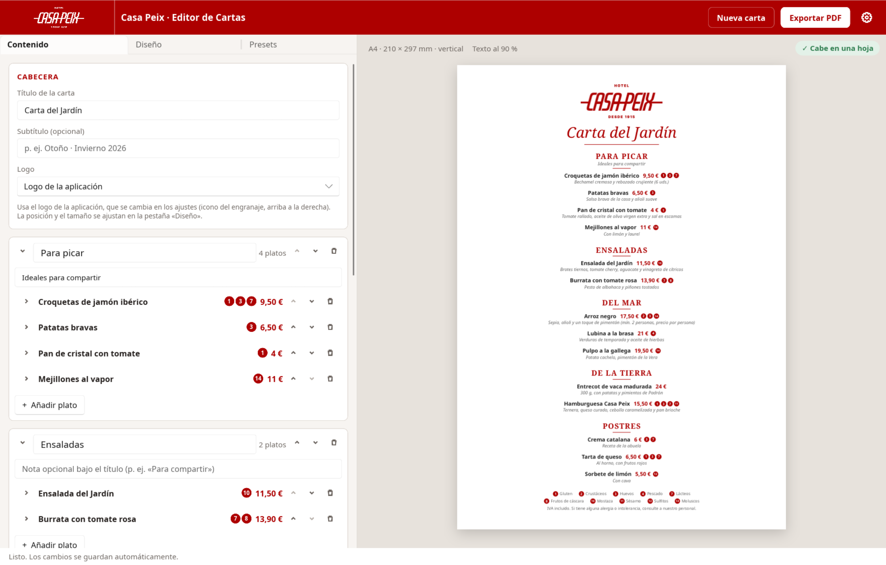

<div align="center">
<br>

<h1 align="center">MenuMaker</h1>


<h3>Desktop app for designing single-page restaurant menus</h3>



</div>

<br>

Desktop app made with [Slint](https://slint.dev) for designing the restaurant menu of
Hotel Casa Peix (Customizable to other restaurants).

- Customizable header with logo: left, centre or right, with adjustable height.
- Sections with dishes: name, description, price and allergens.
- Layout: 1, 2 or 3 columns, aligned left (price column with dot leaders), centre or right.
- Per-role fonts (title, subtitle, sections, dishes, description, price) chosen from the
  system fonts, with size, bold and italic. Also colours, margins, paper size (A4 by default,
  A5, A3, Letter, Legal or custom) and orientation.
- **Always one sheet.** A binary search over a global text scale shrinks the menu until it fits
  and, optionally, enlarges it to fill the page. Columns are balanced, a section title never
  ends up alone at the bottom of a column, and sections are kept together when possible.
- Live preview: the preview is the real PDF rasterised with hayro, so what you see is exactly
  what you export.
- PDF export with [krilla](https://github.com/LaurenzV/krilla) (fonts embedded and subset).
- Presets in SQLite: full menu or design only. Plus autosave and JSON import/export.
- **Not tied to one restaurant.** Customizable app and menu designs.

  Everything defaults to Casa Peix and is saved in SQLite.

## Architecture

```
src/
├── lib.rs                 menu_core: all logic, with no UI dependency
│   ├── domain/            pure data model (menu, sections, dishes, allergens, style, prices)
│   ├── fonts.rs           system fonts (fontdb), metrics/coverage (skrifa), with fallbacks
│   ├── layout/            layout engine
│   │   ├── text.rs        shaping (harfrust) + cache + line breaking
│   │   ├── blocks.rs      header, section titles, dishes, legend → positioned blocks
│   │   ├── flow.rs        column distribution and balancing
│   │   ├── model.rs       DrawOp: text, lines, circles, logo (points, origin top-left)
│   │   └── mod.rs         fit search → PageLayout
│   ├── render/            pdf.rs (krilla) and raster.rs (hayro)
│   ├── engine.rs          facade: MenuDocument → PDF / preview bitmap
│   ├── storage.rs         SQLite (rusqlite, bundled): presets, autosave, app settings
│   ├── settings.rs        app settings (theme, colour, title, logo) + contrast helpers
│   └── paths.rs           data folder via `dirs` (dev.mariinkys.MenuMaker)
├── main.rs                binary `menu-maker`: logging + Slint UI
├── logging.rs             tracing setup (stderr + rolling log file)
└── app/                   UI controller
    ├── mod.rs             connects the Actions callbacks to the core
    ├── editor.rs          document + view state (expanded rows)
    ├── convert.rs         domain ↔ Slint types
    ├── branding.rs        applies app settings to Theme/Branding, reads the settings dialog
    └── preview.rs         background thread with debounce for the preview
ui/                        .slint files (interface only; no logic)
```

Data flows one way: the UI calls `Actions.*`. The controller updates the `MenuDocument`,
then `MenuEngine` lays it out (`layout`) and writes the PDF (`render`). The same text shaping
is used for measuring and for drawing, so positions in the PDF match the layout exactly.

### Translations

Translations use Slint's standard gettext workflow:

- Every user-visible string in `ui/*.slint` is wrapped in `@tr("…")`, with English as the source
  language.
- Messages built in Rust (status bar, file dialogs, default names) are pure functions in
  `ui/strings.slint`, which Rust calls as `ui.global::<Strings>().invoke_…()`. That way they go
  through `@tr` too.
- `translations/<lang>/LC_MESSAGES/menu-maker.po` files are bundled into the binary at build time
  (`with_bundled_translations` in `build.rs`). The language is switched at runtime with
  `slint::select_bundled_translation`.
- Translation contexts are disabled, so the same English string always has one translation.

Texts printed on the menu are part of the menu itself, not the interface. Dish names and titles
are whatever you type. The allergen legend has its own language setting in Design → Allergens.

Updating translations after changing the UI:

```bash
cargo install slint-tr-extractor
slint-tr-extractor --no-default-translation-context --package-name menu-maker \
    -o translations/menu-maker.pot ui/*.slint
msgmerge --update translations/es/LC_MESSAGES/menu-maker.po translations/menu-maker.pot
# translate the new/fuzzy entries (Poedit, Lokalize, a text editor…), then rebuild
```

To add a language, for example French:

```bash
mkdir -p translations/fr/LC_MESSAGES
msginit -i translations/menu-maker.pot -l fr -o translations/fr/LC_MESSAGES/menu-maker.po
```

Then add it to `Language` in `src/domain/language.rs` and to the language combo box in
`ui/settings-dialog.slint`.

### Data and logs

All files live in one folder, resolved with [`dirs`](https://crates.io/crates/dirs):

| OS      | Folder                                                      |
|---------|-------------------------------------------------------------|
| Linux   | `~/.local/share/dev.mariinkys.MenuMaker/`                   |
| macOS   | `~/Library/Application Support/dev.mariinkys.MenuMaker/`    |
| Windows | `%APPDATA%\dev.mariinkys.MenuMaker\`                       |

- `menu-maker.sqlite3` holds the presets, the autosaved document and the app settings.
- `logs/menu-maker.YYYY-MM-DD.log` holds the logs. A new file starts each day, the last 7 are kept, and timestamps are UTC.

Logging uses `tracing`. The library (`menu_core`) only emits events, and the binary sends them to stderr and the log file. The default level is `info` for the app and `warn` for dependencies. Change it with `RUST_LOG`:

```bash
RUST_LOG=menu_core=debug,menu_maker=debug cargo run   # render timings, edits, autosaves
RUST_LOG=menu_maker=trace,menu_core=trace cargo run   # also every keystroke edit and layout pass
```

What gets logged:

- `info`: startup (version, folders), fonts found, database opened or migrated, document restored or loaded, presets saved, loaded or deleted, PDF and JSON export/import, exit.
- `warn`: font fallbacks, unreadable logos, content that does not fit on one page, errors shown in the status bar.
- `error`: database, autosave or preview failures, and panics.
- `debug` / `trace`: individual edits, design changes, font loads, render and raster timings, autosaves.

## Building

```bash
# Linux (Debian/Ubuntu): fontconfig headers
sudo apt install libfontconfig1-dev

cargo run --release             # binary: target/release/menu-maker
cargo test                      # 29 tests: prices, layout, flow, PDF, SQLite, logos, contrast…
```

On Windows and macOS no extra system dependencies are needed.
